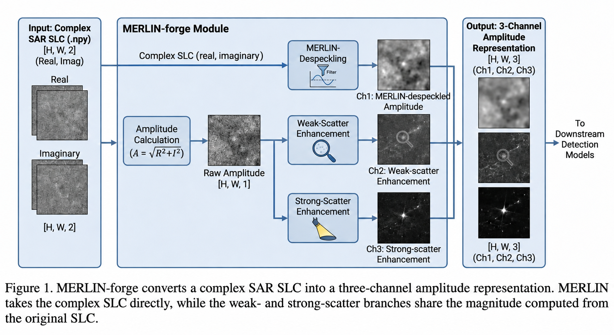

# MERLIN-forge

MERLIN-forge converts a single complex SAR SLC stored as `.npy` (shape `[H, W, 2]`, real/imag) into a 3-channel amplitude representation for downstream detection models. MERLIN uses the complex SLC's real and imaginary components to produce a despeckled amplitude channel. The weak- and strong-scatter enhancement branches share the magnitude computed from the original SLC.



This work is inspired from channel enhancement and combination (Suo et al., 2024) using Merlin (Dalsasso et al., 2022) as the despeckler for distribution and ease of use purposes. 

## Setup

1) Create and activate a conda environment (Python >= 3.10):

```bash
conda create -n merlin-forge python=3.10
conda activate merlin-forge
```

2) Install dependencies (PyTorch and deepdespeckling included):

```bash
conda install -y numpy scipy matplotlib scikit-image tqdm nomkl pyyaml
pip install torch torchvision torchaudio

git clone https://github.com/hi-paris/deepdespeckling.git
cd deepdespeckling
pip install -e .
```

## Quick start

- Visualization:

```bash
python -m merlin_forge.viz --config config.yaml --input path/to/sample.npy --out out.png
```
Running this on Mac creates some issues, managed to bypass them adding ```(KMP_DUPLICATE_LIB_OK=TRUE if needed)```before command (not clean but does the job for now).

- Benchmark:

```bash
python -m merlin_forge.bench --config config.yaml --input_dir path/to/dir --n 50
```

## References

* **MERLIN Despeckling:** Y. Suo, Y. Wu, T. Miao, W. Diao, X. Sun and K. Fu, "Adaptive SAR Image Enhancement for Aircraft Detection via Speckle Suppression and Channel Combination," in IEEE Transactions on Geoscience and Remote Sensing, vol. 62, pp. 1-15, 2024, Art no. 5219415. DOI: 10.1109/TGRS.2024.3435881
* **Channel Enhancement:** E. Dalsasso, L. Denis and F. Tupin, "As if by Magic: Self-Supervised Training of Deep Despeckling Networks with MERLIN," in IEEE Transactions on Geoscience and Remote Sensing, vol. 60, pp. 1-13, 2022, Art no. 5236213. DOI: 10.1109/TGRS.2021.3128621

